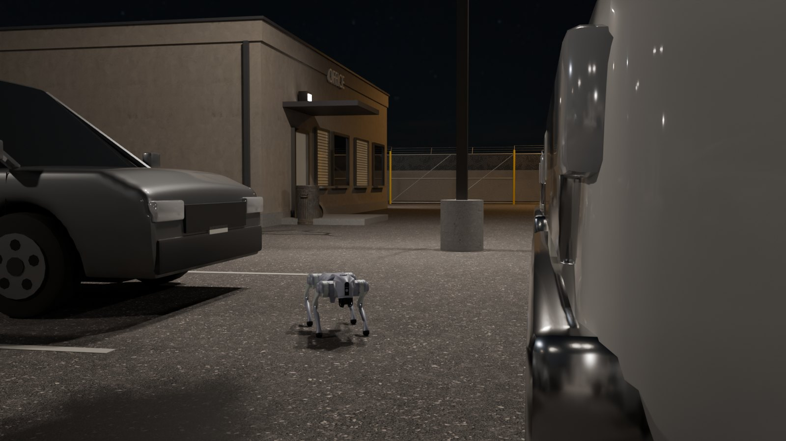
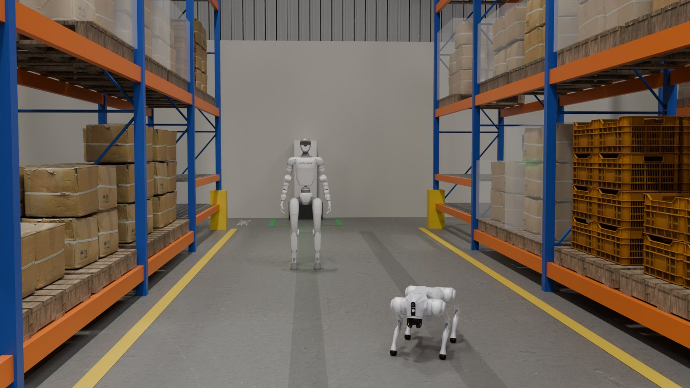
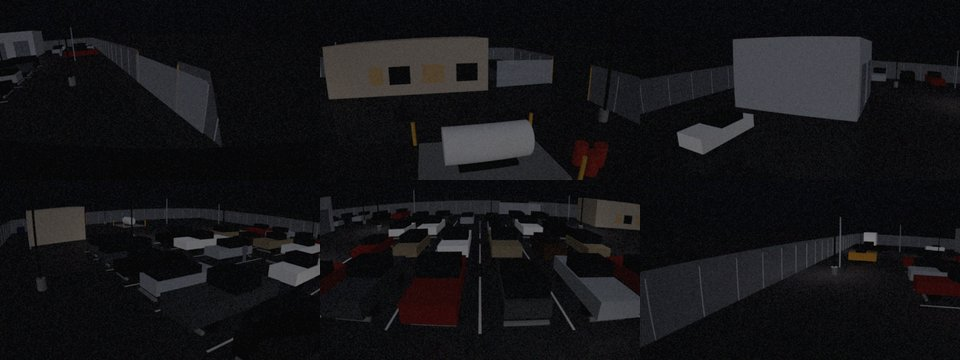
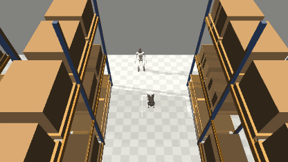
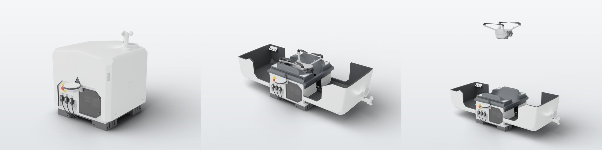

# dimos-worlds

Sim worlds for [DimOS](https://github.com/dimensionalOS/dimos), shipped as DimOS external blueprints.

- **Night vehicle lot.** Outdoor lot with six fixed CCTV cameras (distortion, noise, JPEG-style ISP), named places, and scripted events: person appears, gate opens, vehicle moves.
- **Warehouse.** 30 x 20 m building with pallet racking, pallets, conveyor and pick table, built from a layout file, with a known-occupancy prior map for DimOS's planner.
- **Shared-world fleet.** A Go2 and a G1 (or two of each) in one MuJoCo world, each on its own policy timestep, each with its own DimOS planner, and costmaps that show each robot the other.
- **Navigation-level coordination.** A DimOS module between goals and the planners: right of way from the planned paths, hold short of a shared stretch, yield to a pocket in head-on meetings, automatic retries, deadlock swap, and settling at the goal pose. No goal resends by hand.
- **Demo plant.** 56 x 36 m process plant (control room, three pumps, compressor, tank bund, pipe rack) with 7 analog gauges, motors, valves and drip trays whose readings come from scripted events (`gauge_high`, `gauge_low`, `motor_hot`, `valve_wrong`, `leak`), a known-occupancy prior map, and a Blender render service for photoreal frames from any pose.
- **Drone dock.** A Dock 3-class docking station (two covers, each on a linear actuator modelled as a closed chain) and the M4D-class quadcopter that lives in it, built to DJI's published dimensions as generated meshes and a MuJoCo model; attachable into any MuJoCo world (an example puts it on the night lot's office roof).
- **Arm cell (optional).** A KUKA iiwa 14 on the warehouse pedestal, positional IK pick and place of a tote, as its own DimOS module.
- **Safety watchdog.** A DimOS module between a robot's commands and the robot: stops and latches on a fall or tilt, a lost command link, or stale odometry/IMU, and stays stopped until an explicit reset.
- **Deterministic replay.** A command log plus periodic state hashes. A sim run re-executes bit-identically.





*Optional Blender path: the scenes rendered with Cycles, Menagerie Go2 and G1 placed by hand (stills, not frames of a run). `docs/media/render_heroes.py`.*



*The lot's six CCTV cameras at night, gate 2 open (MuJoCo render + `camera_model.isp`; boxes and flat lighting, not photoreal).*



*`warehouse-fleet`: G1 and Go2 each sent a goal over `*/goal_request`, each driven by its own `ReplanningAStarPlanner`. The GIF is that run's log re-executed and rendered (`docs/media/make_media.py`), sped up about 7x.*

## Why

- DimOS ships two scenes, `office` and `supermarket`. No outdoor, no night, no fixed cameras.
- DimOS multi-robot sim runs one MuJoCo sim per robot, so robots cannot see or collide with each other. Here they share one world.
- DimOS replay replays recorded sensor streams. It does not re-execute a sim run. This does, and checks it with state hashes.

## Status

Early. Targets `dimos==0.0.14`. A CI job tracks DimOS `main` and is allowed to fail. The G1 walks only (its arms do nothing); the only manipulation is the separate arm cell. See [Known limitations](#known-limitations).

## Install

Python 3.12. Not on PyPI yet; install from a checkout. System packages first:

- macOS: `brew install portaudio` (DimOS's Unitree extra builds `pyaudio`).
- Ubuntu/Debian: `sudo apt-get install portaudio19-dev libegl1 libgl1 git-lfs libusb-1.0-0` (PortAudio for `pyaudio`, EGL/GL for headless MuJoCo rendering, `git-lfs` for DimOS's first-use data download, libusb for DimOS's Go2 connection).

```
git clone <this repo> && cd dimos-worlds
uv venv --python 3.12 && source .venv/bin/activate
uv pip install -e ".[dev]"
```

On first use DimOS downloads its MuJoCo robot models and walking policies (`mujoco_sim` data) and MuJoCo Menagerie.

Headless Linux: `export MUJOCO_GL=egl` before `pytest` or `dimos run` (verified on Ubuntu 22.04 with an NVIDIA GPU; GitHub's Ubuntu runner uses Mesa's EGL).

## Run

Blueprints register under the `dimos.blueprints` entry-point group, so DimOS finds them by distribution name:

```
$ dimos list | grep dimos-worlds
  dimos-worlds.go2-lot-night
  dimos-worlds.go2-plant
  dimos-worlds.go2-warehouse
  dimos-worlds.lot-cctv
  dimos-worlds.warehouse-arm
  dimos-worlds.warehouse-fleet
  dimos-worlds.warehouse-fleet-4
```

```
dimos --viewer none run dimos-worlds.go2-warehouse      # Go2 in the warehouse: DimOS's Go2 stack on the warehouse prior map
dimos --viewer none run dimos-worlds.warehouse-fleet    # Go2 + G1 in one shared world, one planner each, coordinated
dimos --viewer none run dimos-worlds.warehouse-fleet-4  # the same with four: Go2, G1, and a second of each on the dock floor
dimos --viewer none run dimos-worlds.warehouse-arm      # the iiwa arm cell on its own (add it to warehouse-fleet the same way)
dimos --viewer none run dimos-worlds.go2-lot-night      # Go2 in the night lot: prior map, named places, events
dimos --viewer none run dimos-worlds.go2-lot-night dimos-worlds.lot-cctv   # ... plus the six CCTV cameras
```

Every robot in these blueprints drives through its own safety watchdog ([Safety watchdog](#safety-watchdog)); `DIMOS_WORLDS_SAFETY=0` leaves it out.

Drop `--viewer none` for the Rerun viewer. The MuJoCo sims run headless; `DIMOS_WORLDS_VIEWER=1` opens MuJoCo's own viewer (needs a display). Run one DimOS instance at a time (`dimos status`, `dimos stop`).

Send a goal from another terminal:

```
dimos-worlds-goal /goal_request 12 11.4        # go2-warehouse
dimos-worlds-goal /goal_request -2 -17         # go2-lot-night (row D, south drive lane)

# warehouse-fleet: one goal topic per robot
dimos-worlds-goal /g1/goal_request 6 11
dimos-worlds-goal /go2/goal_request 12 11.4
```

`dimos-worlds-goal TOPIC X Y [--yaw RAD]` publishes a world-frame `PoseStamped` after waiting 3 s for peer discovery. `dimos topic send` (DimOS 0.0.14) publishes before discovery, so its goal is lost every time on Linux and sometimes on macOS. The planner logs `Got new goal` when a goal lands.

Watch odometry with `dimos topic echo /odom PoseStamped` (go2-warehouse, go2-lot-night), or `dimos topic echo /go2/odom PoseStamped` and `/g1/odom` (warehouse-fleet). In warehouse-fleet, `/go2/arrived` and `/g1/arrived` (Bool) say when a robot is at its goal, settled. Give the type name explicitly. A fresh `echo` can print nothing for 10-20 s while it discovers peers: echo longer.

Warehouse coordinates: metres, origin at the south-west inside corner, x east, y north. The cross aisle runs along y = 11.4. The Go2 starts at (3, 11.4), the G1 at (1, 11).

## Coordination

In `warehouse-fleet`, goals go to `FleetTraffic` (`dimos_worlds.coord`), not straight to the planners. It forwards each goal to that robot's planner (`{id}/nav_goal`), reads back the path the planner follows (`{id}/path`) and its result (`{id}/goal_reached`), and compares every pair of remaining paths. Two paths that come closer than the two bodies need to pass (radius + radius + 0.3 m), at a spot both robots reach within 8 m, are a conflict, and one robot gets the right of way:

1. A robot with no goal (parked, or settling) standing on an active robot's path moves to a pocket and comes back afterwards.
2. A robot already on the other's path, while the other is not on its path, goes first (a crossing, or a robot being followed). The other holds.
3. Both on each other's path (head-on in an aisle): the lower priority robot yields to a pocket, the nearest free spot off the winner's whole remaining path that it can reach without passing the winner. No pocket for it: the other yields.
4. Neither yet on the other's path: whoever reaches the shared spot first by more than 3 s goes, otherwise priority (list order in `robots.warehouse_fleet()`: Go2, then G1). The other holds.
5. Three or more robots each holding for the next (A for B, B for C, C for A; each robot's goal is held by the next one), every one stopped or blocked for 5 s: a hold cycle. Each pairwise decision is right on its own, so nobody would move. The lowest priority robot in the cycle that has a pocket steps aside for the robot holding for it; the ring unwinds behind that one, and the robot in the pocket gets its goal back once nobody's path comes near its own.

6. Close quarters, whatever the right of way says: a robot with a goal whose next 0.8 m of path, or where its current velocity takes it in 1.5 s, comes closer than both radii + 0.15 m to another body (and closer than that body is now) stops, and walks on once that has been clear for 1.5 s. It catches a loser that has not moved aside yet (its pocket unreachable, or it yields to two robots at once) and a body walking off its planned path.

With three or more robots, a pocket also keeps off every other robot's remaining path (a parked robot: its spot) and is never reached through another body; when no such spot exists, it keeps off the winner's path only. A robot yielding to two winners whose pocket lies on the second one's path gets a new one; with no pocket at all it backs off 1 m, to the free spot furthest from the winner's way, instead of standing in it.

A holding robot walks until it is 1 m short of the shared stretch and stands there (its planner gets its own pose as the goal) until the stretch moves on or clears. A yielding robot gets the pocket as its goal and its real goal back once the winner's path no longer comes near its own. A planner that gives up, or reports arrival away from the goal, gets the goal again after 3 s. If the robot with the right of way makes no progress for 25 s, the right of way is swapped. Every decision is logged (`traffic: ...`).

When the planner reports arrival, the G1 closes the last position and heading error itself (holonomic velocity commands, at most 0.15 m/s, to 0.12 m and 6 degrees); the Go2 corrects heading only (its small forward commands sit in the policy's dead band). More than 30 degrees off heading, it turns in place first and translates after: walking sideways or backwards while turning hard, the G1 walked off forwards at up to 0.8 m/s, 1.6 m from its goal in one jittered ring run. A G1 that stays within 1 m of its goal for 20 s without its planner reporting arrival (at 0.22 m/s and 0.22 rad/s it turns on a ~1 m radius and can circle a goal it reaches at an angle) is stopped and settles from where it is. Then `{id}/arrived` is published.

The rules (`coord/traffic.py`) are pure numpy, robot-agnostic, and know nothing about the warehouse: robots are ids with a radius, a priority and an optional settle config. `coord.module.traffic_coordinator(ids, name)` builds the DimOS module for any set of robot ids.

Scripted scenarios run the same stack in one process (the world, DimOS's own `GlobalPlanner` per robot, the robot-aware costmaps, the coordinator), each goal sent once:

```
python -m dimos_worlds.coord.scenarios head-on --runs 5    # aisle A-B, 2.5 m wide: Go2 and G1 start at opposite ends, each bound past the other
python -m dimos_worlds.coord.scenarios crossing --runs 5   # Go2 east along the cross aisle, G1 south down the 1.6 m east aisle across it
python -m dimos_worlds.coord.scenarios head-on --no-coord  # the same, planners only
python -m dimos_worlds.coord.scenarios head-on --realtime  # planner and coordinator threads on the wall clock, as live
python -m dimos_worlds.coord.scenarios three-way   # Go2 from the west, G1 from the north, a second Go2 from the dock, one junction
python -m dimos_worlds.coord.scenarios convoy      # Go2, G1, Go2 in a line through the 2.5 m aisle C-D, ~2 m apart
python -m dimos_worlds.coord.scenarios ring        # four robots (G1 + three Go2) on a 2.4 m square, each bound for the next one's corner
python -m dimos_worlds.coord.scenarios mixed       # the same ring with two G1s and two Go2s, alternating
python -m dimos_worlds.coord.scenarios ring --seeds 50 --jobs 6   # start poses jittered (2 cm, 0.02 rad), seeds 0-49, 6 at a time
```

By default a scenario is stepped on sim time (`coord.stepped`, `coord.inproc`): world ticks, odometry, each planner's local and monitor loop, the coordinator and the costmaps run from one loop in a fixed order, at the live rates, with no threads or sleeps. The same scenario gives the same result on any load (checked with every core busy) and runs faster than real time. Across platforms the physics still differs in the last bits, and the G1 walk is chaotic, so an x86_64 run can take a different path than an arm64 run. `--realtime` (tests: `DIMOS_WORLDS_REALTIME=1`) runs the live timing; its outcome depends on machine load.

Stepped, macOS arm64, start poses jittered by up to 2 cm and 0.02 rad, 100 seeds per scenario:

| | head-on | crossing | G1 settle |
|---|---|---|---|
| before (G1 at full planner speed) | 84/100, G1 fell in 14 | 97/100, G1 fell in 3 | 87/100, G1 fell in 10 |
| now | 100/100, no falls | 100/100, no falls | 99/100, no falls (one run settled 0.29 m off) |

Why the G1 fell, and the two changes that stop it: told to slow down or stop while walking forward (settling after an overshoot, an in-place turn after walking, holding a pose), the G1 leans forward, speeds up and falls. A zero command is a backwards one to its policy (DimOS adds -0.18 drift compensation), so above 0.2 m/s forward its tracked vx command no longer goes below the policy's neutral (`world.NEUTRAL_VX`). On its own that removes the falls but the G1 then overshoots where the planner stops it, sometimes into a rack's inflation where DimOS's A* finds no path. So the G1's planner also runs at 0.4 of its speed (`RobotSpec.nav_speed`, DimOS `nerf_speed`: 0.22 m/s, 0.22 rad/s). Each alone, 30 seeds of head-on and settle: neutral floor 25/60 passed, no falls; planner at 0.4, 59/60 passed, 1 fall; both, 59/60, no falls. The `warehouse-fleet` blueprint applies the same speed: each robot's planner is `fleet.planner.FleetPlanner`, DimOS's `ReplanningAStarPlanner` with a `nav_speed` module setting. The planner's config is derived inside its worker from the run's config, so command-line overrides still apply (a run-wide `--nerf-speed` multiplies with each robot's).

Measured earlier on macOS (Apple Silicon), real time, each goal sent once:

| scenario | coordinated | planners only |
|---|---|---|
| head-on | 5/5: Go2 arrives in 38-81 s, G1 in 104-147 s, both within 0.24 m and 9 degrees; G1 yields every run, one run needed the deadlock swap; closest 0.88 m between centres | 0/2: once the Go2's planner gave up and left it in the cross aisle; once both arrived but the bodies came within 0.63 m of each other (radii add up to 0.65) and the Go2 stood 173 degrees off its goal heading |
| crossing | 5/5: Go2 arrives in 22-25 s, G1 in 48-50 s, both within 0.09 m and 11 degrees; the G1 holds short of the crossing every run; closest 1.20 m | 0/2: the Go2's planner reports arrival without moving (see limitations) |

Live, with `dimos run dimos-worlds.warehouse-fleet` and each goal published once: Go2 and G1 sent to opposite ends of aisle A-B (head-on), the G1 yielded to a pocket in the east aisle, the Go2's planner gave up once next to it and got its goal again from the coordinator, both arrived (G1 0.05 m and 2 degrees off, Go2 0.09 m and 5 degrees), and `dimos-worlds-replay` matched all 54 state hashes of that run.

Live again with the G1's planner at 0.4 speed, macOS (Apple Silicon): the G1 first sent to the east end of aisle A-B (19.8, 15.35) and the Go2 to its west end (3, 15.35), then each sent past the other (Go2 to (21.7, 15.35), G1 to (1.1, 15.35)), each head-on goal published once with `dimos-worlds-goal`. Three runs: both arrived every run (Go2 in 42-44 s, G1 in 149-152 s, Go2 within 0.16 m, G1 within 0.08 m of the goal), the G1 yielded to a pocket by the east aisle every run, closest 0.96 m between centres, the G1's odometry height never below 0.69 m (it counts as fallen below 0.45), no `fell` event in any run log, G1 top speed over odometry 0.34-0.43 m/s. `dimos-worlds-replay` matched every state hash of all three runs (66, 64 and 244).

Three and four robots, stepped, macOS arm64, each goal sent once (one run each; stepped runs repeat exactly):

| scenario | result |
|---|---|
| three-way | all arrive: Go2 22 s, second Go2 60 s, G1 66 s, all within 0.09 m and 8 degrees; the second Go2 holds while the first leaves the cross aisle; closest 1.05 m; no falls |
| convoy | all arrive: Go2 40 s, second Go2 75 s, G1 107 s, within 0.19 m and 10 degrees; both followers keep their distance; closest 2.07 m; no falls |
| ring | all four arrive: second Go2 23 s, G1 52 s, third Go2 58 s, Go2 86 s, within 0.25 m and 10 degrees; hold cycle broken at 5 s; closest 1.22 m; no falls. Without the hold-cycle rule the pairwise deadlock swap got there too, after 25 s of standing still: last arrival 137 s |

Start poses jittered by up to 2 cm and 0.02 rad (`--seeds`), stepped, macOS arm64, seeds 0-49 (head-on and crossing 0-19):

| | three-way | convoy | ring | mixed (2 G1 + 2 Go2) | head-on | crossing |
|---|---|---|---|---|---|---|
| passed | 50/50 | 50/50 | 50/50 | 40/50 | 20/20 | 20/20 |
| closest approach, any run | 1.01 m | 2.03 m | 0.98 m | 0.38 m | | |
| G1 falls | 0 | 0 | 0 | 0 | 0 | 0 |

Before the close-quarters stop and the settle changes, ring was 19/20 (one run 0.69 m, under the 0.7 m bar: a G1 settling 172 degrees off heading walked 1.6 m away from its goal and back past a parked Go2) and 49/50 on seeds 0-49 with only the settle change (a G1 circled its goal for 100 s, then wedged itself at the conveyor). `mixed` fails 10 of 50: in every failure the Go2 bound east from the south-west corner and the G1 coming down the west side to that corner meet just west of it, where the G1's wide turn (it turns on a ~1 m radius at its planner speed) runs through the Go2's pocket; the two end up 0.4-0.6 m apart, and in 8 of the 10 neither reaches its goal. Planners only (`--no-coord`), one run each: three-way 0/1 (the first Go2's planner reported arrival at the start, 9.6 m from its goal), convoy 0/1 (the G1 never left its start), ring 0/1 (nobody moved).

## Safety watchdog

DimOS (0.0.14) has no Go2 fall detection and no stop on a lost command link in its stack. In its MuJoCo sim the robot keeps walking on its last velocity command (the sim's controller holds whatever was written last); what the real Go2 firmware does when commands stop is not checked here. `SafetyWatchdog` (`dimos_worlds.safety.module`) sits between a robot's command source and the robot and passes commands through until one of these trips it:

| trip | when |
|---|---|
| `fall` | roll or pitch past 40 degrees for 0.1 s, from the `imu` input (or the odometry orientation while no IMU message has been seen) |
| `link_lost` | the last command asked for motion and no command came for 0.5 s (DimOS's local planner sends at 10 Hz while it drives) |
| `odom_stale` | no odometry for 0.5 s, once odometry has been seen |
| `imu_stale` | no IMU for 0.5 s, once an IMU message has been seen |

A trip latches: from then on the watchdog sends zero velocity, on every tick and in place of every command, until a reset (`reset` RPC, or `True` on `safety_reset`). A reset is refused while roll or pitch is above 15 degrees or odometry or the IMU is stale, and a command from before the reset is not resumed. Every trip, reset and refused reset is published on `safety_alert` (JSON: `t`, `kind`, `message`, `latched`, ...) and handed to `watchdog.on_alert` callbacks in-process; `safety_stopped` carries the latch.

Every shipped blueprint inserts it, one per robot: `warehouse-fleet` and `warehouse-fleet-4` between each robot's MovementManager (and the coordinator's settling commands) and the sim (`{id}/cmd_vel_unsafe` -> watchdog -> `{id}/cmd_vel`; alerts on `{id}/safety_alert`, latch on `{id}/safety_stopped`, reset with `True` on `{id}/safety_reset`), `go2-warehouse` and `go2-lot-night` between MovementManager and the Go2 connection. `DIMOS_WORLDS_SAFETY=0` in the environment of `dimos run` builds them without it. A teleop source must keep sending while it wants motion (the dead-man): a single key press that sends one command trips `link_lost` after 0.5 s.

Live, `dimos --viewer none run dimos-worlds.warehouse-fleet-4`, macOS (Apple Silicon, under heavy load from other jobs), one run: all four sent across the warehouse at once (each goal once), all arrived, no alert. Then the Go2 and G1 sent on again and the second G1 sent walking; 6 s later an 80 N m roll push on its trunk (`sim_push`): `fall` 0.38 s after the push (roll -22, pitch -67 degrees), the second G1 stayed put (0.004 m in the 20 s after the sim stood it back up) while the other two arrived. Then the second Go2 driven by a 10 Hz teleop stream on `go2b/tele_cmd_vel` (`dimos-worlds-send --every 0.1`) and the sender killed mid-walk: `link_lost` 0.49 s later, stopped (0.38 m while braking, 0.0 m in the next 10 s), no alert on any other robot. Both reset over `{id}/safety_reset`; the second G1 then walked to a new goal. `dimos-worlds-replay` matched all 36 state hashes of that run, the push included.

```python
from dimos_worlds.safety.module import SafetyWatchdog

autoconnect(..., SafetyWatchdog.blueprint(robot="go2")).remappings([
    (MovementManager, "cmd_vel", "cmd_vel_unsafe"),
    (SafetyWatchdog, "cmd_vel_in", "cmd_vel_unsafe"),
])
```

The rules are plain Python (`safety.watchdog.Watchdog`, time passed in by the caller) and take a Unitree lowstate as DimOS's Go2 connection receives it (`Watchdog.lowstate(msg, now)` reads `imu_state.rpy`). DimOS's Go2 connection keeps that lowstate to itself and DimOS's MuJoCo sim emits none, so the module's `imu` input is a `sensor_msgs.Imu`; the `lowstate` RPC takes the dict.

Tested against a walking Go2 (0.5 m/s, commands every 0.1 s) in the shared MuJoCo world, stepped on sim time (`tests/test_safety_sim.py`): walking tilt peaks at 2.8 degrees (G1: 5.3); a 40 N m roll push trips `fall` while the body is still tipping, before it hits the floor; a reset is refused while it lies on its side; once the sim stands it back up it stays put although the sender keeps asking for 0.5 m/s, and walks again only after a reset. Commands cut mid-walk: `link_lost` 0.52 s after the last command, stopped within 0.1 m; without the watchdog the same Go2 walks on. Odometry cut: `odom_stale`, stopped.

## Demo plant

`go2-plant` runs DimOS's Go2 stack in the plant (MuJoCo gait, `ReplanningAStarPlanner` on the plant's prior map), starting at the dock (5.0, 23.6). Places (`go_to_place` skill): the dock, one station per instrument group, stay-out zones over the stairs.

```
dimos --viewer none run dimos-worlds.go2-plant
dimos-worlds-goal /goal_request 22.55 13.175    # the P-101 gauge stand
```

The plant's state is a list of events in a state file (`DIMOS_WORLDS_PLANT_STATE`, default `/tmp/dimos-worlds-plant-state.json`); `plant_state.truth(events)` gives every instrument's value. Dials start at 225 degrees and sweep 270 degrees clockwise.

Photoreal frames (Blender 5.2 + Cycles, a GPU; not a Python dependency):

```
python src/dimos_worlds/plant/assets/fetch.py       # Poly Haven (CC0) textures and HDRIs
python src/dimos_worlds/plant/make_textures.py      # dial faces, plates and signs
/path/to/blender -b --factory-startup --disable-autoexec -P src/dimos_worlds/plant/render/build_scene.py   # builds plant/assets/cache/plant.blend
DIMOS_WORLDS_BLENDER=/path/to/blender dimos-worlds-plant-render --port 8790
curl -s localhost:8790/v1/view -d '{"pos":[22.55,13.5,0.32],"dir":[0,0.66,0.75],"hfov_deg":30,"w":1280,"h":720,"light":"day"}' > view.jpg
```

`/v1/view` renders the camera from a pose with the current events applied (needles, valve positions, leaks), optional head lamp. `motor_hot` only changes the motor temperatures in `plant_state.truth`; no frame shows heat. `DIMOS_WORLDS_CYCLES_DEVICE=CUDA` skips OptiX when its kernels fail to compile on your driver.

### Gauge rounds

`python -m dimos_worlds.plant.gauge_loop --out runs/day1 --events gauge_low:TG-201:8` walks the round with a gauge reader and an active-perception agent in the loop: every agent action (walk, aim, zoom, lamp) becomes a DimOS goal or a render request, and every step is logged (`steps.jsonl`, `poses.jsonl`, `results.json`, raw and annotated frames). It needs the render service and `go2-plant` running, and gauge-rounds importable as `gaugerounds`. gauge-rounds is a separate package (the OpenCV 5 analog gauge reader and the agent) and is not public, so this loop does not run from this repo alone. Everything else in the plant works without it.

One run on Ubuntu 22.04 (RTX 3090, Cycles CUDA), PTZ payload, `--only PG-401,TG-201 --events gauge_low:TG-201:8`: PG-401 read 6.55 bar (truth 6.6, 0.5% of span), TG-201 read 8.43 °C (truth 8, 0.4% of span) and called low, 8 views, 3.0 min.

## Arm cell

`warehouse-arm` puts MuJoCo Menagerie's `kuka_iiwa_14` (fetched with DimOS's Menagerie copy, not vendored) on the pedestal by the conveyor, with a suction tool, and makes tote-09 at the conveyor's end a free body. Commands name two reach targets from `layout.json` (`conveyor`, `pick_table`, `pallet-2`):

```
dimos --viewer none run dimos-worlds.warehouse-arm
dimos-worlds-send /arm_command 'String("conveyor pick_table")'   # dimos topic send, after peer discovery
dimos topic echo /arm_status String     # above conveyor ... gripped; lifting ... released at pick_table ... done conveyor pick_table 26.617 11.993 0.813
```

The IK is positional (tool tip position, tool pointing straight down at a fixed heading, damped least squares from a few starts), the motion is minimum-jerk between IK solutions, tracked by the model's own joint servos with gravity compensation. It publishes `arm_joint_state` and `tote_pose`.

## Drone dock



`dimos_worlds.dock` is a drone docking station and its quadcopter in MuJoCo: generic models (not DJI products, not endorsed by DJI, no logos or marks) built to the dimensions DJI publishes for its Dock 3 and Matrice 4D. Every number in `dock/spec.json` carries its source (a DJI spec page or manual, a measurement on DJI's dimensioned drawings, or an estimate marked UNVERIFIED); the source URLs are in [`dock/README.md`](src/dimos_worlds/dock/README.md#sources). No mesh file is committed: `shapes.py` builds every mesh with manifold3d on first use.

```
python -m dimos_worlds.dock.check                     # envelopes vs spec, cover timing, launch/land, clearances (JSON, exit 1 on failure)
python -m dimos_worlds.dock.preview --out dock.jpg    # preview sheet: closed / half / open, overview + the three cameras
python -m dimos_worlds.dock.lot_example               # on the night lot's office roof: open, fly over row D, land, close
```

```python
from dimos_worlds.dock.sim import DockSim
sim = DockSim()
sim.open(); sim.run_until_idle()     # covers 0 -> 90 degrees in the spec's 5 s
sim.takeoff(3.0); sim.land(); sim.close(); sim.run_until_idle()
jpeg = sim.feed_jpeg("dock_internal")   # also dock_external (fisheye), drone_wide
```

`fixture.attach_dock(spec, pos, yaw_deg, prefix)` puts the station and quadcopter into any `MjSpec` (bodies, joints, cameras renamed with `prefix`); `DockSim.from_model(model, prefix)` drives it there. Closing is refused while the quadcopter is in the cover sweep. The quadcopter is held by a force/torque controller (it launches and lands with real contacts; it is not a flight-dynamics model). The dock is not in a DimOS blueprint yet: no robot commands go through it. Measured on macOS arm64 (`python -m dimos_worlds.dock.check`): closed envelope within 3 mm of DJI's 640 x 745 x 770 mm (L x W x H, gauge and RTK module included), covers open and close in 5.02 s, landing 0.5 mm off the pad centre, 30 mm between the parked quadcopter and the closed covers. Open length is 1736 mm against DJI's 1760 (DJI's own drawings disagree there by 12-19 mm), and the 5 s cover travel is an estimate: DJI publishes none.

## Replay

`warehouse-fleet` writes `warehouse-fleet-run.jsonl` in the working directory: a header (scene sha256, robot specs, versions), every command with the tick it landed on, and a state hash every 250 ticks (5 s of sim time).

```
$ dimos-worlds-replay warehouse-fleet-run.jsonl
run: scene warehouse, robots go2, g1, 731 commands, 20 state hashes; recorded with {'mujoco': '3.15.0', 'platform': 'Linux-x86_64', 'dimos': '0.0.14', 'onnxruntime': '1.31.0', 'numpy': '2.5.3', 'dimos-worlds': '0.1.0'}
  tick 2540: g1 fell
  tick 2590: g1 recovered
  tick 3317: g1 fell
  tick 3367: g1 recovered
OK: 20 state hashes match; final state adee78f798939661 at tick 5000
```

A log only replays bit-exact on the stack it was recorded on. A macOS arm64 log replayed on Linux x86_64 (and the other way round) diverges at its first state hash, and replay says which recorded version or platform differs.

`python -m dimos_worlds.replay RUN.jsonl` does the same. Exit status is 0 when every hash matches and 1 at the first divergence. `--until TICK` stops early.

## Cook your own scene

Both worlds are generated, then cooked into a DimOS scene package: MJCF + `places.json` + `scene.meta.json`, the last written with DimOS's own `ScenePackage.write_metadata`.

```
python -m dimos_worlds.warehouse.gen_layout   # layout.json: building, racks, pallets, places, cameras
python -m dimos_worlds.warehouse.scene        # cooks warehouse/scene/ from layout.json
python -m dimos_worlds.lot.gen_lot            # cooks lot/scene/
```

To make your own: copy one of these packages, change the generator and cook it. Register a blueprint in your own `pyproject.toml` under `[project.entry-points."dimos.blueprints"]`, then `dimos run <your-dist>.<blueprint>`. `tests/test_warehouse.py` shows the checks a scene package should pass: DimOS loads it, it is static, and it composes with DimOS's Go1/G1 models.

Optional Blender renders (Blender 5.2, not a Python dependency):

```
python src/dimos_worlds/lot/assets/fetch.py         # Poly Haven (CC0) + Blender human base meshes, ~165 MB
python src/dimos_worlds/warehouse/assets/fetch.py   # Poly Haven + Menagerie G1, Go2, iiwa, ~100 MB
DIMOS_WORLDS_BLENDER=/path/to/blender python src/dimos_worlds/warehouse/render/render.py --out out/ --lights night,day
DIMOS_WORLDS_BLENDER=/path/to/blender python docs/media/render_heroes.py   # the README stills
```

Assets are fetched at build time into `*/assets/cache/`, never committed. `download.blender.org` refuses some cloud IPs (403); `fetch.py` then names the file to download by hand.

## Known limitations

- **Verified on macOS (Apple Silicon) and Ubuntu 22.04 x86_64 (RTX 3090, EGL).** On Linux: the test suite, the opt-in lot e2e, the five original blueprints under `dimos --viewer none run` (goals sent and arrival checked on odometry; warehouse-arm's conveyor-to-pick-table move), replay of a Linux-recorded run, and the Blender render path. The coordinated head-on test (`test_coord_fleet.py`) failed once in three Linux runs; both robots arrived in the failing run too. CI runs the tests on GitHub's Ubuntu and macOS runners. Not tried: Linux arm64, Windows, Linux without a GPU outside CI.
- **Blender path: stills only.** The builders, `warehouse/render/render.py`, the lot's `render/render_frames.py` and `docs/media/render_heroes.py` ran (Blender 5.2.2, Cycles/OptiX). Robots in those renders are placed, not driven by a sim run; `build_scene.py --state` (posing a recorded moment) has not been run.
- **Bit-exact replay needs the same stack.** Replay needs the MuJoCo, ONNX Runtime, numpy and OS/CPU architecture the run was recorded on (the log header records them). macOS arm64 and Linux x86_64 logs do not replay on each other. A changed scene file is refused.
- **G1 arrival times are chaotic across platforms.** Same commands, different float rounding: on Linux x86_64 the G1 overshoots a route corner and turns in place where macOS arm64 does not, and arrives about 8 s later (25 s vs 17 s in the fleet test). It still arrives. Each platform is deterministic with itself. In one coordinated warehouse-fleet run on Linux the G1 fell twice (recovered, arrived); replay reproduces the falls. That was before the neutral floor and the 0.4 planner speed; the live runs since are macOS only.
- **Policy dead bands are compensated, not fixed.** DimOS's Go1/Go2 walking policy barely turns in place below about 0.8 rad/s and does not walk forward below about 0.3. The G1 policy walks about 1.45x the command, under-turns while walking and creeps when standing. The compensation is explicit per-robot config (`robots.Compensation`, recorded in every run log header): Go2 in-place turns from `cmd_vel` are raised to 0.8 rad/s and the route controller has its own floors; the G1's `cmd_vel` is tracked as a velocity (feed-forward + PI on measured velocity) and it holds its pose at zero command. `WarehouseFleetSimConfig.compensate=False` turns it all off. go2-warehouse (DimOS's own Go2 sim connection) raises slow in-place turns the same way. All numbers were measured in this sim, not on hardware.
- **`dimos-worlds-goal` can still lose a goal.** It waits 3 s for peer discovery, but in the live runs above 1 of 16 goals never reached FleetTraffic (macOS). A goal that landed shows as a `traffic: <id> goal (...) [requested]` log line and a message on `/<id>/nav_goal`; if neither appears, send it again.
- **Four robots live: one run.** `warehouse-fleet-4` ran once live (the drill above); the coordination numbers are from the stepped scenarios. `mixed` (two G1s, two Go2s) passes 40/50: a G1's wide turn through a Go2's pocket can still bring the two within 0.4 m and leave both stuck (see the sweep above). The hold-cycle rule breaks a cycle of holds; a cycle of yields, or a cycle with no free floor for any member, still falls back to the pairwise deadlock swap, which can swap a whole ring at once.
- **The coordinator does not know about safety stops.** A robot latched by its watchdog keeps its goal in the coordinator, which may keep other robots waiting for it; in the drill the others' routes did not need its spot.
- **Safety watchdog: sim only.** In every blueprint and run live in sim, never on hardware. The 40 degree tilt threshold, the 0.5 s timeouts and the pushes are sim values, UNVERIFIED on a real Go2. Its timeouts run on the wall clock: a sim falling far behind real time (odometry gaps over 0.5 s) trips `odom_stale`.
- **Coordination is conservative.** Any two paths that come within passing distance count as a conflict, even in a 3.3 m aisle where the planners could squeeze past each other, so one robot waits. There are no timed reservations: the decision uses where the paths go and estimated arrival, not a schedule.
- **A pocket needs free floor.** A 2.5 m aisle is too narrow to step aside in (bodies plus margins need about 2.7 m), so a yielding robot backs out of the aisle. A dead-end with no pocket falls back to holding and the deadlock swap.
- **DimOS's planner sometimes reports arrival without moving.** When a robot already faces along its new path, `ReplanningAStarPlanner` (dimos 0.0.14) can go straight to its final rotation and report the goal reached at the start. The coordinator sees the robot is not at the goal and sends the goal again 3 s later; without the coordinator the robot just stays.
- **Slow corners look "stuck" to DimOS.** Its sim stuck check (under 1 m in 8 s) fires repeatedly while the Go2 turns around rack ends. The planner replans each time and still arrives: 2 min 10 s from (3, 11.4) to (15, 7.5) in one verified run.
- **Go2 goal pose is the planner's.** The Go2 settles its heading only (11 degrees off at worst in the runs above); its position is where DimOS's planner stops it, up to about 0.25 m off.
- **The arm cell is a separate simulation.** It has its own MuJoCo model and thread: the walking robots do not see it move (they keep out of its stay-out anyway), and arm runs are not in the shared world's run log or replay. The suction grip is kinematic (the gripped tote follows the tool). One tote is free; the others stay static scenery.
- **Plant gauge rounds assume a PTZ head.** The camera is 0.32 m up on an assumed pan-tilt-zoom payload (tilt to 70 degrees, optical zoom to 4x), UNVERIFIED on hardware; `--stock-camera` uses the Go2's own camera (body pitch, digital zoom). Pan, tilt and the last turn toward a dial are render-only: the sim dog does not pitch and does not walk the final yaw. DimOS's planner stops within about 0.25 m of a goal, so moves shorter than 1 m are overshot by 0.25 m. Rendered frames are not camera captures.
- **The gauge reader needs OpenCV 5 with contrib.** DimOS 0.0.14 installs `opencv-contrib-python` 4.x (it pins `<5`); gauge-rounds needs OpenCV 5.x with the contrib modules. Having both installed works (cv2 5.0.0 resolved to the contrib build in our run), but pip can leave mixed versions; check `python -c "import cv2; print(cv2.__version__); cv2.ximgproc"`.
- **The plant has run on Linux only.** `go2-plant`, the render service and the gauge loop have run on Ubuntu 22.04 x86_64 (RTX 3090, Cycles CUDA); on macOS only `tests/test_plant.py` has run.
- **Drone dock: kinematics and contacts, not aerodynamics.** Each cover swings on one fitted hinge (end poses match DJI's drawings, the path between is approximate). The cover travel time and several hidden depths are estimates (UNVERIFIED, labelled in `dock/spec.json`). Only `tests/test_dock.py` and the lot-roof example have run (macOS arm64); the dock has no DimOS module.
- **MuJoCo visuals are boxes with flat lighting.** Fine for pipelines and change detection, not for judging what a real night camera sees.
- **Lot CCTV frames are rendered, not recorded.** Camera model parameters are typical datasheet values, UNVERIFIED against any specific camera.

## Credits

DimOS (Dimensional Inc., Apache-2.0), MuJoCo Menagerie Unitree and Drake models (BSD-3-Clause), Poly Haven assets (CC0). Full list in [NOTICE](NOTICE).

## License

Apache-2.0. See [LICENSE](LICENSE).

Built by Isaiah Bjorklund.
